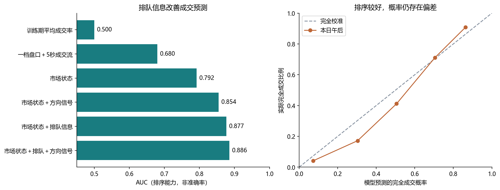
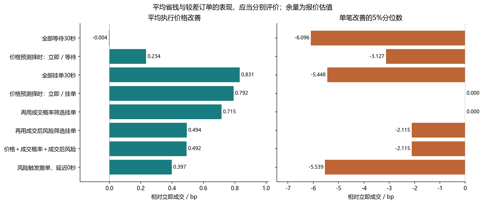
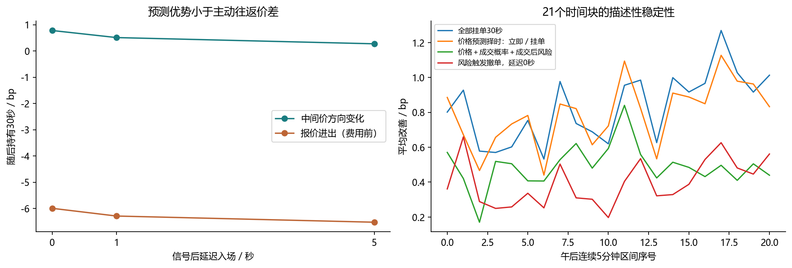

> 归档阅读说明：正文保留实验形成时的结论和运行记录；当前文件夹的复现与提交方式以[归档首页](../../README.md)为准。

# 从价格因子到可执行决策：Level-2 因子研究最终报告

研究数据：2026-09-23，上证50相关样本50只股票；报告日期：2026-10-13。

**核心判断：这批数据最有价值的用途，是研究一笔既定交易应当何时做、怎样做。已经观察到的方向优势较小，尚不足以支持靠主动往返交易获利；排队信息对成交预测的价值，比目前对成交后风险的预测更明确。**

本报告汇总前两轮发现，并实际完成第三轮实验：新建 21,500 个逐笔模拟任务、88,069 条未完成订单状态，拟合9组简单模型，比较11种执行规则。原始ZIP只读，清洗、标签、模型和报告均为独立派生文件。

## 1. 最有启发的六个发现

- **方向有信息，但信息的量级不等于可交易利润。** 一档盘口强信号的30秒有利中间价变化约0.781bp，而同样样本的两端价差约6.778bp；按买卖报价进出，费用前已约−5.997bp。1bp=0.01%。把因子转成执行择时，才可能利用这个小优势。
- **“哪边更厚”与“我排在哪里”回答不同问题。** 本轮完整成交模型午后AUC为0.886；保留方向和市场状态、去掉订单排队信息时为0.854。一档盘口与5秒成交流单独预测成交只有0.680。改善不只是股票之间的差异：完整模型的逐股平均AUC为0.796。
- **顺着初始盘口挂单，未必能拿到顺着盘口的收益。** 上轮“顺初始盘口”订单成交率29.6%，已成交部分随后30秒方向变化−0.876bp；“逆初始盘口”订单成交率69.6%，对应变化+0.121bp。能成交的订单已经经过市场路径的筛选。
- **会预测成交，不代表会预测坏成交。** 完整成交后风险模型午后秩相关约0.115，但MSE相对训练均值基线改善率为-1.45%，绝对风险预测没有胜过简单基线。它不适合直接作为精确撤单阈值。
- **增加预测目标不保证增加执行价值。** 三目标规则平均改善0.492bp，高于仅按价格选择立即／等待的0.234bp，却低于简单的价格条件挂单0.792bp。相对后一个公平基线，增加风险筛选后均值与所测尾部指标都变差；目前不能把复杂规则当作升级方案。
- **更快地执行错误撤单，并不会更好。** 风险触发撤单的零延迟规则仅改善0.397bp；撤单慢5秒反而为0.505bp。这揭示当前撤单目标与执行目标不一致，不能解释成“延迟越大越有利”。

上述数字都是本日探索性结果。上午、下午已在前轮研究中被观察过；本轮严格按时间训练和评价，仍不构成一份从未看过的新数据检验。

## 2. 数据基础与本轮实验设计

### 2.1 数据可以支持什么

原始包包含6,276,360条订单记录、3,792,934条成交记录、252,631条快照，共10,321,925条。此前清洗将250条合法状态消息单列，区分连续竞价、集合竞价和盘后；未发现需要删除的完全重复记录、空值或非法价格精度。没有用插值制造逐笔订单。

一个关键质量发现是：部分快照的标称时间与其包含的成交内容并不完全同步。因此，本研究的可交易特征与未来中间价均由逐笔事件重建，不用快照中的“未来内容”解释当前市场。模型也不读取标签列、未来报价列，或前轮用整段上午拟合的组合分数。

模拟复用本项目的上交所规则回放引擎。每只股票每分钟设置一个买入和一个卖出任务；主板100股、科创板200股，卖出使用独立任务账户中的已有可卖库存。每次任务重置资金和库存，不把买卖配对视为同日买入后立即卖出的组合。参考历史市场不受我们的模拟订单反向影响，因此只用于小订单反事实研究。

### 2.2 时间划分与任务数

| 区间 | 任务开始时刻 | 任务数 | 用途 |
|---|---|---|---|
| 训练 | 09:35 ≤ t < 10:50 | 7,500 | 拟合缺失值填充、尺度、模型系数 |
| 隔离 | 10:50 ≤ t < 10:55 | 500 | 不训练、不计入策略评价 |
| 上午留后 | 10:55 ≤ t < 11:25 | 3,000 | 时间外推诊断 |
| 午后复核 | 13:05 ≤ t < 14:50 | 10,500 | 同日较远时段复核 |

挂单截止为初始下单后30秒；成交后标签再看30秒。最后一笔训练任务开始于10:49，其最迟标签到10:50，与10:55开始的留后任务有间隔。标签不跨午休或收盘竞价。

每个挂单在0、5、10、15、20、25秒观察一次，只记录仍有剩余量的状态。新挂单和存续挂单分别拟合模型；每个已观察状态等权，不按未来最终能留下几条观察记录赋权。后者会把未来成交速度隐含带入训练，是本轮审计中特别排除的错误。存续状态存在同一订单重复及时间相关，不能将88,069条状态视为独立样本。

模型采用固定正则的逻辑回归与岭回归，缺失值中位数和标准化只在训练段拟合，标准化输入裁剪至±5。没有搜索午后最优参数；新增的输入和决策组件对照全部披露。固定的50%成交概率、−0.5bp风险阈值只是实验规则，未被证明最优。

## 3. 把下一轮目标落成三个可计算标签

令订单方向s为买入+1、卖出−1，m为中间价，τ为后续实际模拟成交时刻，T为本笔任务的30秒截止时刻。方向统一后，“正的价格变化”表示成交后持有有利，但也意味着尚未完成的同方向订单继续等待可能更贵。

| 研究目标 | 本轮标签 | 回答的问题 | 适用范围 |
|---|---|---|---|
| 价格变化 | s×log(m(t+30)/m(t))×10000 | 此刻应当更着急完成，还是可以等待？ | 新订单／当前存续状态 |
| 完全成交概率 | 剩余量在T前是否全部成交 | 在这个价位和排队位置，剩余时间够不够？ | 所有未完成订单，包括最终不成交者 |
| 成交后风险 | 有后续成交时，按成交量加权的s×log(m(τ+30)/m(τ))×10000 | 若真的成交，随后价格是否容易对自己不利？ | 条件于后来有成交，未成交记为缺失而非0 |
| 执行结果 | s×(立即成交价−执行均价)/初始中间价×10000 | 同一笔任务是否买得更低、卖得更高？ | 包含全部未成交余量的截止报价估值 |

输入包含一档及多档盘口、5/30秒主动成交方向、OFI、短期动量、VWAP偏离；市场状态包含价差、过去波动、事件活跃度、一个价格跳动对应的bp及买卖方向；订单信息包含存续时间、前方排队量、剩余量、限价偏离当前最优价的跳数，以及“前方队列／过去30秒对手方向成交量”的对数指标。

**不能把“价格预测＋成交概率×成交后风险”直接相加当利润。** 它们的条件、起点和期限不同；成交后30秒可能晚于任务截止，且成交概率与价格路径相关。最终动作必须在同一任务、同一截止时间和同一成本基准下比较。

## 4. 盘口与订单流：存量、消耗和时效应当分开

一档不平衡OBI=(买一量−卖一量)/(买一量+卖一量)。在其他条件相近时，较薄一侧更容易先被主动成交或撤单耗尽；近5秒成交流则记录近期实际消耗的方向。两者合用能区分“看起来厚”与“有实际成交流支持”。这是机制解释，本样本的相关关系不能证明因果。

前轮午后分组中，盘口和主动成交同时偏买时，未来30秒平均中间价变化+0.925bp；盘口偏买而成交偏卖时约+0.103bp。但前者平均价差也达到9.254bp，而且64.7%的30秒中间价标签不变。较大条件均值不能直接译成较高胜率或足够支付价差的收益。

| 前轮组合（上午拟合） | 5秒逐股平均IC | 30秒IC | 120秒IC |
|---|---|---|---|
| 一档盘口 | 0.250 | 0.188 | 0.142 |
| 盘口＋5秒主动成交 | 0.238 | 0.196 | 0.151 |
| 再加多档深度 | 0.220 | 0.204 | 0.180 |
| 再加OFI | 0.223 | 0.204 | 0.180 |

这提示把模型分成快慢两个用途：很短时限的下单紧迫性保留一档信息；较慢的持续方向再考虑深度和成交流。把所有因子堆成一个分数，可能改善120秒而削弱5秒。这里都是累计窗口相关，不是已识别的信号半衰期；要估计衰减，应检查延迟后尚未实现的增量预测。

盘口不平衡预测下一次中间价变化的机制与[Gould与Bonart的研究](https://arxiv.org/abs/1512.03492)相呼应；其市场和样本不同，不能直接移植参数。[Cont等关于订单簿事件的研究](https://arxiv.org/abs/1011.6402)讨论OFI与价格变化的关系；同期价格冲击解释力也不等于可提前获得的收益预测力。

## 5. 成交概率：排队信息是本轮最明确的增量

| 输入模型 | 上午留后AUC | 午后AUC | 午后逐股平均AUC | 午后Brier误差 |
|---|---|---|---|---|
| 训练期平均成交率 | 0.500 | 0.500 | 0.500 | 0.261 |
| 一档盘口＋5秒成交流 | 0.637 | 0.680 | 0.755 | 0.239 |
| 市场状态 | 0.824 | 0.792 | 0.609 | 0.189 |
| 市场状态＋方向信号 | 0.857 | 0.854 | 0.772 | 0.161 |
| 市场状态＋排队信息 | 0.879 | 0.877 | 0.785 | 0.145 |
| 市场状态＋排队＋方向信号 | 0.882 | 0.886 | 0.796 | 0.141 |

AUC衡量排序：从一个完全成交订单和一个未完全成交订单中随机各取一个，模型把前者排得更高的概率；0.5相当于无排序能力，**0.886不表示88.6%的订单被准确分类**。Brier误差是预测概率与0/1结果差值的均方，越小越好。

公平的增量对照是“市场状态＋方向信号”对“再加排队信息”：午后AUC从0.854到0.886；另一方向，“市场状态＋排队”再加方向信号，从0.877到0.886。两组信息互补，但当前队列对成交这个目标尤其直接。

市场状态模型混合全部股票时AUC较高，逐股平均却明显降低，说明一部分能力来自识别不同股票的流动性差异。完整模型逐股平均仍为0.796，最低约0.622，因此并非只有跨股票识别能力。所有成交标签均来自本模拟器；预测它们准确，还不代表实盘成交模型已经被验证。

| 预测概率区间 | 任务数 | 平均预测 | 实际完全成交 |
|---|---|---|---|
| 0%—20% | 2,564 | 7.2% | 4.1% |
| 20%—40% | 1,436 | 30.3% | 17.1% |
| 40%—60% | 1,813 | 50.5% | 41.1% |
| 60%—80% | 2,750 | 70.4% | 71.1% |
| 80%—100% | 1,937 | 86.3% | 90.8% |

完整模型午后平均预测完全成交率49.0%，实际45.8%。预测20%—40%的组实际只有约17.1%，而最高一组实际高于预测。因此“能排序”和“能按概率做预算”还差一步校准；不能直接把50%作为可靠的实盘分界。



**为什么排队重要：** 同样看涨的买入信号，前面100股与前面10万股是完全不同的订单。还要看有多少主动卖出正在消耗买方队列、前方撤单能否推进自己的位置、队列是否被新价位取代。队列量除以近期消耗量，可作为等待难度的近似，但不是精确预计等待秒数；撤单、补单和流量变化都会改变它。

## 6. 成交后的风险：选择偏差比因子方向更重要

此前发现，顺初始盘口的挂单前方队列中位数约44,500股，逆初始盘口约3,940股。若厚买盘之后价格上涨，排在买一后面的订单可能根本买不到；只有后来卖盘足够强、厚队列被消耗时它才成交。把这些成交后的路径单独拿出来看，当然可能不再具有最初的看涨特征。

因此应区分：所有下单时刻的未来价格、真正成交这一条件下的未来价格、以及成交价相对未来中间价的标记价值。未成交不能简单删掉后宣称策略赚钱，也不能把其成交后风险设为0。对一笔已经挂了20秒的订单，还应使用“活到现在仍未成交”的条件模型。

| 目标／模型 | 上午留后秩相关 | 午后秩相关 | 午后MSE改善率 | 午后绝对误差/bp |
|---|---|---|---|---|
| 30秒价格变化 | 0.119 | 0.152 | 2.20% | 2.450 |
| 成交后30秒变化：方向＋状态 | 0.112 | 0.084 | -2.00% | 3.354 |
| 成交后30秒变化：再加排队 | 0.132 | 0.115 | -1.45% | 3.353 |

此处秩相关为混合订单的Spearman相关，不与前轮逐股IC直接比较。MSE改善率定义为1−模型均方误差／训练期同类标签均值预测的均方误差；负数说明精度更差。

完整风险模型午后对后来有成交的新订单，平均预测-0.684bp，实际-0.288bp，明显偏悲观。训练段的实际平均风险约-0.785bp；完全成交率也由训练段57.1%降至午后45.8%。同一天不同时间段已经出现分布变化，用上午的绝对风险阈值机械控制下午撤单，容易过度撤单。

对于未成交或很少成交的状态，条件风险预测还涉及训练支持不足。报告不把这些预测当作已验证事实；概率模型能够描述“可能成交”，不自动补足“成交后会怎样”的证据。

## 7. 将预测用于真实问题：同一笔任务如何执行

所有规则使用相同任务及30秒截止；改善为正表示相对立即完成这笔任务买得更低或卖得更高。挂单余量均按截止时对手盘估值，没有丢弃未成交者，也没有把估值冒充实际补单成交。

价格模型预测同方向价格将上涨（预测≥0）时立即成交；否则允许等待或挂单。成交概率筛选要求预测≥50%；风险筛选要求预测的成交后30秒变化≥−0.5bp。不通过筛选的订单等到30秒按报价估值。三目标规则同时使用两个筛选。

| 执行规则 | 上午留后均值/bp | 午后均值/bp | 午后5%分位/bp | 午后被动成交量占比 |
|---|---|---|---|---|
| 立即按对手盘完成 | 0.000 | 0.000 | 0.000 | 0.0% |
| 全部等待30秒 | -0.032 | -0.004 | -6.096 | 0.0% |
| 价格预测择时：立即／等待 | 0.170 | 0.234 | -3.127 | 0.0% |
| 全部挂单30秒 | 0.646 | 0.831 | -5.448 | 45.9% |
| 价格预测择时：立即／挂单 | 0.591 | 0.792 | 0.000 | 27.3% |
| 再用成交概率筛选挂单 | 0.554 | 0.715 | -0.000 | 25.0% |
| 再用成交后风险筛选挂单 | 0.398 | 0.494 | -2.115 | 13.5% |
| 价格＋成交概率＋成交后风险 | 0.395 | 0.492 | -2.115 | 13.4% |

**比复杂度更重要的是对照基准。** 三目标规则相对“价格择时：立即／等待”增加约0.257bp，但要判断成交／风险模型是否有用，还必须与“价格择时：立即／挂单”比较；后者不需要这两个额外模型。新增预测头是否帮助省钱，应看表中的逐项加入结果，不能只挑最弱基线。

与全挂单相比，三目标规则的5%分位从-5.448bp改善到-2.115bp，确实呈现均值与较差结果之间的取舍。但简单的价格条件挂单已经能更好地处理这个取舍。三目标规则在该基线之上反而退步，因此不能据此宣称风险模型改善了执行风险。

| 规则 | 比立即成交更差的任务比例 | 最差5%任务的平均改善/bp |
|---|---|---|
| 全部挂单30秒 | 14.34% | -9.311 |
| 价格预测择时：立即／挂单 | 4.86% | -4.647 |
| 再用成交概率筛选挂单 | 4.89% | -4.674 |
| 价格＋成交概率＋成交后风险 | 6.71% | -5.603 |
| 风险触发撤单，延迟0秒 | 16.57% | -9.495 |

价格条件挂单的5%分位约为0，不表示没有亏价任务：仍有4.86%的任务比立即成交更差，最差5%的平均改善约-4.647bp。5%分位只是位置阈值；额外报告最差5%均值，是为了避免大量立即成交任务的0值掩盖尾部损失。这些单日尾部数字也不是跨日风险保证。

午后价格规则恰好一半立即、一半等待，是同一时刻买卖成对、方向相反的实验设计所致。盲等30秒的均值接近0也部分来自这种配对抵消。以后应换成实际策略产生的下单时点、方向与数量重新评价。



### 7.1 动态撤单实验：一个有价值的失败结果

先全部挂单；订单仍未完成时，每5秒更新风险预测，最早在5秒第一次低于−0.5bp则触发撤单。分别假设撤单0、1、5秒后生效；这段延迟中继续允许成交，最晚在30秒截止。撤掉的余量不再重挂，到原30秒截止再按报价估值。

| 撤单延迟 | 午后改善/bp | 被动成交量占比 | 触发撤单后、撤单生效前成交股数 | 不合申报量要求的余量任务占比 |
|---|---|---|---|---|
| 0秒 | 0.397 | 27.0% | 0 | 0.248% |
| 1秒 | 0.411 | 28.1% | 14,338 | 0.305% |
| 5秒 | 0.505 | 32.7% | 70,450 | 0.324% |

零延迟撤单比静态挂单少改善约0.434bp，并没有改善5%分位数。这说明当前规则过多放弃有价值的成交。慢撤单保留了一些本来被撤掉的成交，导致平均执行改善反而回升；这是对这条规则的反证，不是对延迟有利的一般结论。

更深的原因是目标不一致：我们用“成交后30秒价格可能不利”触发撤单，但评价的是“必须完成的订单截至原30秒是否省钱”。较差的成交后价格变化，不必然意味着这笔既定交易应该放弃当前限价成交。更合适的撤单目标是同一截止时间下，“继续挂单”相对“撤掉并按既定后续方式完成”的成本差，并加上未完成风险。

撤单反事实通过截断固定参考市场中的模拟成交路径实现，没有模拟其他交易者对撤单的反应。延迟期间部分成交改变余量时，截止余量沿用触发时剩余量对应的终点深度均价，存在小订单深度近似；不应把0.01bp级差异当成确定效果。部分余量不满足本模拟器再申报量要求的比例已单列。

## 8. 成本与速度，应当成为因子定义的一部分

### 8.1 主动交易：先比较优势与价差量级

| 入场延迟 | 随后30秒中间价变化/bp | 两端价差损耗/bp | 报价进出、费用前/bp |
|---|---|---|---|
| 0秒 | 0.781 | 6.778 | -5.997 |
| 1秒 | 0.511 | 6.803 | -6.291 |
| 5秒 | 0.274 | 6.801 | -6.527 |

这是前轮OBI强信号样本，分别延迟0、1、5秒后开始持有30秒。两端损耗近似为入场半价差加退出半价差；价差稳定时约等于一个完整买卖价差，不是两次完整价差。这里尚未扣佣金等费用。

0秒到1秒，价格优势从0.781bp降为0.511bp；到5秒只剩0.274bp。这是观察到的预测衰减，不是某条实盘通信线路的延迟测量。固定在信号后30秒退出时，延迟1／5秒的优势约0.498／0.256bp，入场报价分别恶化约0.306／0.547bp。执行速度会同时改变价格、排队位置和可用的预测剩余期限。

被动报单也不只是“晚一点挂到同一个位置”：上轮保留原限价、延迟1／5秒到达，有约3.3%／9.6%的任务在到达时发生主动成交。原来想赚取价差的订单可能变成支付价差的订单。报单到达延迟和本轮撤单生效延迟是不同实验，不能混用结论。

有关限价策略、逆向选择与延迟之间的机制，可参见[Lehalle与Mounjid的研究](https://arxiv.org/abs/1610.00261)。本项目的具体量级来自上述单日实验，不由论文替代实测。

### 8.2 执行改进：看能容忍多少新增摩擦

| 额外执行摩擦/bp（假设） | 价格择时剩余改善/bp | 三目标规则剩余改善/bp | 全挂单剩余改善/bp |
|---|---|---|---|
| 0.00 | 0.234 | 0.492 | 0.831 |
| 0.10 | 0.134 | 0.392 | 0.731 |
| 0.25 | -0.016 | 0.242 | 0.581 |
| 0.50 | -0.266 | -0.008 | 0.331 |
| 1.00 | -0.766 | -0.508 | -0.169 |

这张表只做透明情景计算：在相对立即成交的改善上，额外减去每笔任务0—1bp的新增摩擦。它不是实际券商费率，也不重复扣双方相同的成本。对必须做的同一笔交易，共同佣金可能抵消；新增拆单、最低收费、多一次补单、滑点及未完成惩罚则不会自动抵消。

例如0.5bp新增摩擦足以吃掉本轮价格择时的全部均值优势，也几乎吃掉三目标规则的优势。不能因为几十万条记录得到稳定正相关，就忽略这点经济量级。此前“每单最低5元”的例子只是费用情景，真实费率需要以实际账户为准。

### 8.3 描述性稳定性与局限

| 规则 | 改善为正的股票 | 21个5分钟块中为正 | 最差5分钟块均值/bp |
|---|---|---|---|
| 价格预测择时：立即／等待 | 41/50 | 21/21 | 0.009 |
| 全部挂单30秒 | 50/50 | 21/21 | 0.532 |
| 价格预测择时：立即／挂单 | 49/50 | 21/21 | 0.440 |
| 价格＋成交概率＋成交后风险 | 48/50 | 21/21 | 0.170 |
| 风险触发撤单，延迟0秒 | 47/50 | 21/21 | 0.197 |



逐股和5分钟块的结果能帮助识别是否被少数股票或某一时段驱动，但同一日股票受共同冲击，邻近任务及未来标签也相关。这些计数不是独立显著性检验；不据此推年化收益、夏普比或跨日置信区间。

## 9. 下一阶段该研究什么：已完成结果决定优先级

| 优先级 | 下一阶段目标 | 具体实验及对照 | 通过标准／停止条件 |
|---|---|---|---|
| P0 | 验证小优势能否跨日保留 | 增加不同波动、成交活跃度和价格状态的交易日；按日滚动训练、校准、留出，保留最后一段完全不看的日期；用真实策略发单分布重做本轮规则 | 加入账户实际成本后仍有执行改善；逐日及主要股票组稳定。新日期显著失效时停止加复杂模型，先查状态漂移 |
| P1 | 把成交排序变成可用概率 | 固定当前排队基线；在独立校准段做概率校准，比较按剩余时限／队列消耗状态的校准；再加入前方撤单率、耗尽速度与补单速度 | 同时改善Brier、概率分组误差和执行结果；仅提高AUC但概率失准不算通过 |
| P1 | 撤单真正能否省成本 | 标签直接取同截止时刻继续挂单与撤单后既定补单方案的成本差；将未完成和再申报量约束计入。对照静态挂单、价格择时挂单、当前失败撤单规则 | 扣除撤改与补单增量成本后，改善均值或明确约定的尾部目标；不得仅凭成交后markout更好就保留 |
| P1 | 信号的剩余有效期限 | 针对1／5／10／30／60秒分别训练；按事件数与时钟时间双重评价，在给定0／1／5秒延迟后重新计算尚未实现的价格优势 | 在实际可达延迟下仍有正的剩余动作价值；不能用0延迟结果替代 |
| P2 | 识别“消耗被补回”与“持续消耗” | 以同价位队列为单位，分解新增、撤单、主动成交；构造补单／消耗比、消耗持续性、前方队列流失率，与现有盘口＋成交流匹配对照 | 在控制价差、股票和波动后，仍增量改善特定时限成交或执行；重复OBI的信息直接剔除 |
| P2 | 检验容量与撮合假设 | 在新数据上分档增加数量与参与率；比较严格排队、保守限制新增穿价推断的成交模型；加入真实补单、资金底仓、撤改延迟与市场冲击 | 效果不能主要依靠一种乐观撮合假设；容量与成本曲线能够解释失效点 |

本轮已完成的是三个目标的标签、简单可复现模型、输入对照、三目标决策及撤单延迟实验。表中跨日检验、真实补单、容量与市场反馈尚未完成，因为当前只有这一天行情与小订单固定历史回放。最值得继续投入的是**排队成交预测和同一任务的动作成本比较**；成交后风险模型可继续研究，但当前证据不足以让它单独控制撤单。

## 10. 可复现交付与证据边界

报告对应的主要文件均在 `reports/final_research_20260923/`：

| 文件 | 内容 |
|---|---|
| `最终因子研究报告.md`、`最终因子研究报告.html` | 本报告；HTML内嵌图表，可单独阅读 |
| `experiment_spec.json` | 时间区间、模型、规则和同日探索边界 |
| `tasks.parquet`、`fills.parquet` | 21,500个任务与逐笔模拟成交 |
| `observed_states.parquet`、`labeled_states.parquet` | 当时可知的订单状态及单独的未来评价标签 |
| `model_parameters.json`、`predicted_states.parquet` | 训练期参数和预测；标签、预测不得反过来做原始因子输入 |
| `model_metrics.parquet`、`model_stock_metrics.parquet`、`fill_calibration.parquet` | 全部模型、区间、逐股与概率分组结果 |
| `policy_tasks.parquet`、`policy_summary.parquet`、`policy_choices.parquet` | 所有规则逐任务结果、汇总和动作分布 |
| `policy_stocks.parquet`、`policy_time_blocks.parquet` | 逐股与5分钟块描述性检查 |
| `policy_tail_risk.parquet` | 相对立即成交的亏价比例与最差5%任务均值 |
| `research_summary.json`、`manifest.json` | 核心数字、源文件SHA256与研究代码哈希 |

在项目根目录、前两轮派生数据已经生成的条件下运行：

```powershell
python -B -m research.final_study all
python -B -m research.final_report
python -B -m unittest discover -s tests -v
```

仅从本轮已保存模拟结果重新生成标签、模型和策略统计时，用 `python -B -m research.final_study analyze`。完整依赖和前两轮生成命令见 `research/README.md`。生成数据和报告沿用项目规则默认不进入Git；本轮没有提交或推送。

本轮已运行42项测试，覆盖行情时间、撮合顺序、资金与库存、部分成交、延迟报单、清洗边界、未来标签隔离、训练尺度、撤单触发和未来依赖权重等。测试验证实现约束，不证明经济结果能在实盘复现。

原始ZIP的SHA256保持为 `18c0e124a9c68eb2f77b965ca1f29c93bb30339d7db45245e1af3c0420c6c947`。报告中的成交是模拟标签，余量为报价估值，新增穿价挂单撮合含反事实推断；没有市场反应、完整真实费率、真实网络时延或跨日未见样本。因此，本报告给出的成果是一套有证据支持、可继续验证的执行因子研究框架，而非已验证的盈利策略。
